# Mediater 🍿

**Mediater** is a self-hosted streaming server that looks and feels like Netflix — profiles, an autoplaying billboard, hover previews, Top 10 rows, a Netflix-style player — with a built-in **download-only torrent client**: preview a movie and stream it while it downloads. Nothing is ever uploaded or shared, and finished titles move into your library.

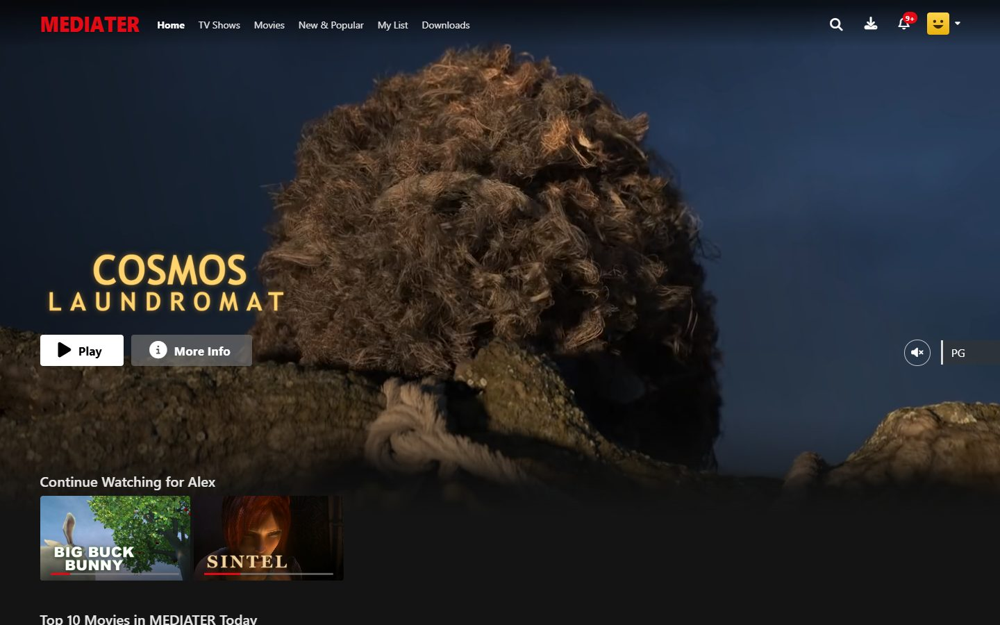

## 📑 Table of Contents

- [Features](#-features)
- [Screenshots](#-screenshots)
- [Prerequisites](#-prerequisites)
- [Quick start](#-quick-start)
- [Upgrading from 2.x](#-upgrading-from-2x)
- [Downloading with torrents](#-downloading-with-torrents)
- [Posters, logos & episode names (TMDB)](#-posters-logos--episode-names-tmdb)
- [Makefile shortcuts](#-makefile-shortcuts)
- [Environment variables](#-environment-variables-env)
- [Server deployment](#-server-deployment)
- [Safety checklist](#-safety-checklist-before-going-public)
- [Player keyboard shortcuts](#-player-keyboard-shortcuts)
- [HTTP endpoints](#-http-endpoints)
- [Project structure](#-project-structure)
- [Troubleshooting](#-troubleshooting)

---

## ✨ Features

**Feels like Netflix**
* **"Who's watching?" profiles** — up to 5 per account, each with its own Continue Watching, My List, ratings and recommendations. **Kids profiles** only see kid-rated titles. **Profile Lock**: any profile can require a 4-digit PIN. One sign-in can be shared: *Who's watching?* comes first after every sign-in (and whenever the browser is reopened), so nobody ends up in the admin's profile without its PIN. Knowing the account password doesn't get around a PIN: only the account owner can remove family members' PINs (from their own profile), the admin's own PIN can only be reset on the server, account settings open only from the owner's profile, and wrong PINs lock that profile on that device for longer and longer.
* **Billboard** with the title logo, Top 10 rank and a muted **video preview** that starts after a few seconds.
* **Rows** — Continue Watching, *Top 10 Movies / TV Shows Today* (with the big outlined numbers), Trending, New on Mediater, *Because you watched…*, genres, Critically Acclaimed, Watch It Again.
* **Hover cards** that grow out of the poster and play a preview, with Play, My List, 👍 ratings (*Not for me / I like this / Love this!*) and *% Match*.
* **Details modal** with seasons dropdown, episode list with progress, *More Like This* and *About*.
* **Netflix-style player** — Skip Intro, next-episode countdown with *Watch Credits*, *Are you still watching?* after three episodes in a row, episodes panel, Audio & Subtitles menu (any language), playback speed, seek-bar thumbnails, "You're watching" pause screen, *More Like This* when a movie ends, resume where you left off.
* **Phone layout** like the Netflix app — bottom tabs, big centre controls, Speed · Lock · Episodes · Audio & Subtitles · Next Ep., screen lock. Installable as an app.
* **New & Popular**, live search, genre pages, notifications for new arrivals.

**Plays anything**
* MP4/WebM play directly; **MKV, AVI, HEVC/H.265, 10-bit, AC3/DTS/multi-audio** files are converted on the fly with ffmpeg (cheap remux when possible, full transcode only when needed). Seeking works in both cases.
* Subtitles: `.srt`/`.vtt`/`.ass` files and subtitles embedded in MKVs.

**Built-in torrent client — download only** (admin)
* **Never uploads or shares**: peers are never sent any data, not even the file list. When a download finishes, Mediater disconnects from the swarm, the title moves into the library and the download leaves the list.
* **Search** for something to download, safest results first: the built-in source is the **Internet Archive** (free, legal public-domain and Creative Commons films and TV); you can also connect **Jackett or Prowlarr**. Torrents that look fake or dangerous are hidden, and program files (`.exe`…) are never downloaded.
* Add a **magnet link, a .torrent file or URL** — or drag & drop / paste it anywhere on the Downloads page.
* **Preview before downloading**: see the file list, pick files, play any video instantly.
* **Stream while downloading** — the admin sees the title right away with a progress badge.
* **Everyone else just watches**: family and kids profiles never see downloads, badges or half-downloaded titles — a movie or episode shows up (as *New*) once it's ready.
* **Season packs** become a series with episodes; bundled subtitles and `poster.jpg` are picked up automatically.
* Live speed, peers, ETA, piece map, pause/resume, speed limit — survives restarts.

**Library & admin**
* Only the account owner's main profile can manage the library and download — other profiles and viewer accounts get a plain Netflix experience.
* Optional **TMDB** integration: posters, backdrops, title logos, trailers, cast, maturity ratings, episode names — for uploads and downloads.
* Full title editor (artwork, video, trailer, skip-intro markers, subtitles, episodes), users, branding, 5 languages (EN/IT/ES/FR/TR), SSO (OIDC), Docker/PM2/systemd.

---

## 📸 Screenshots

| | |
|---|---|
| 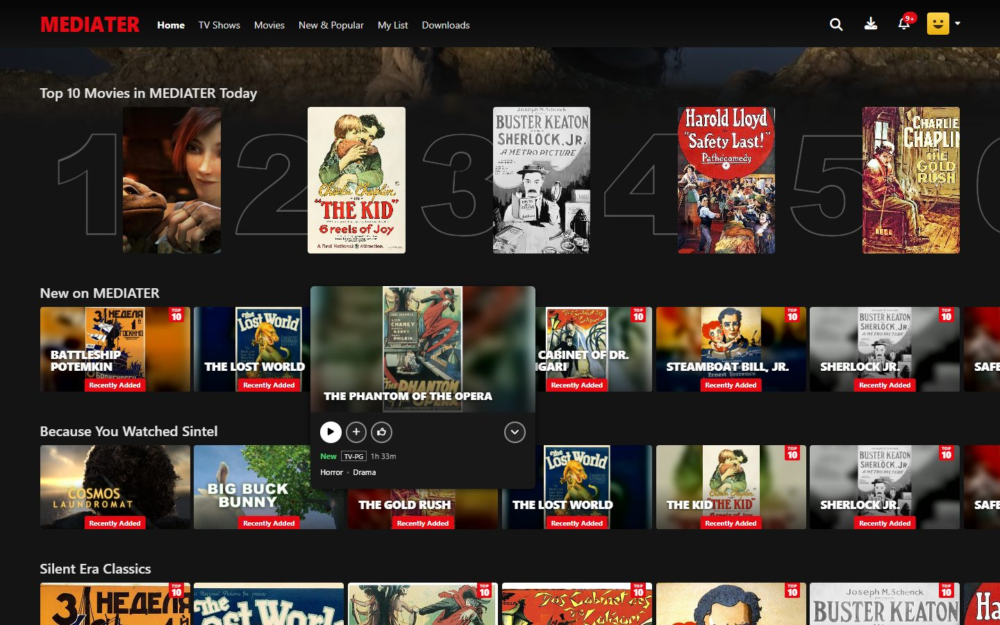 | 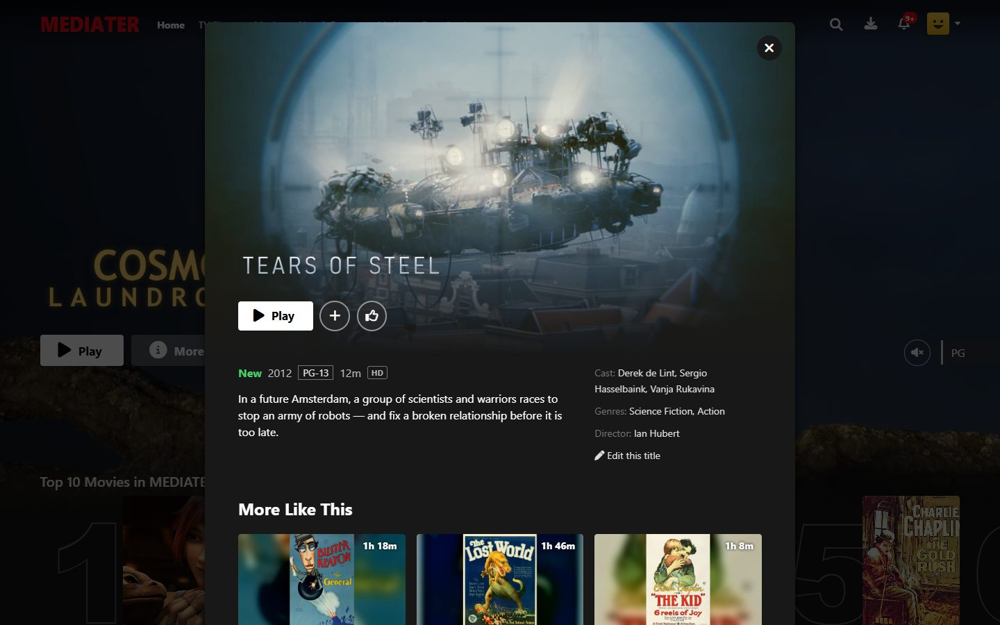 |
| *Hover cards grow out of the poster and play a preview* | *Details, More Like This, cast* |
| 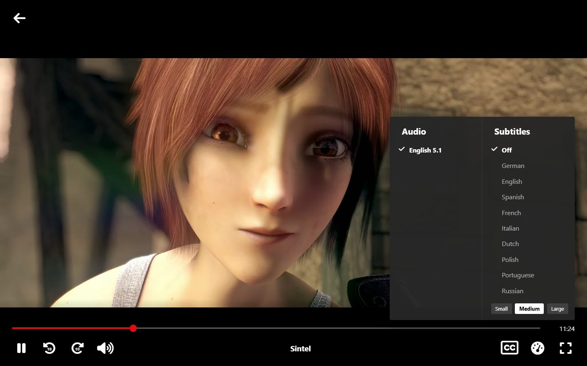 | 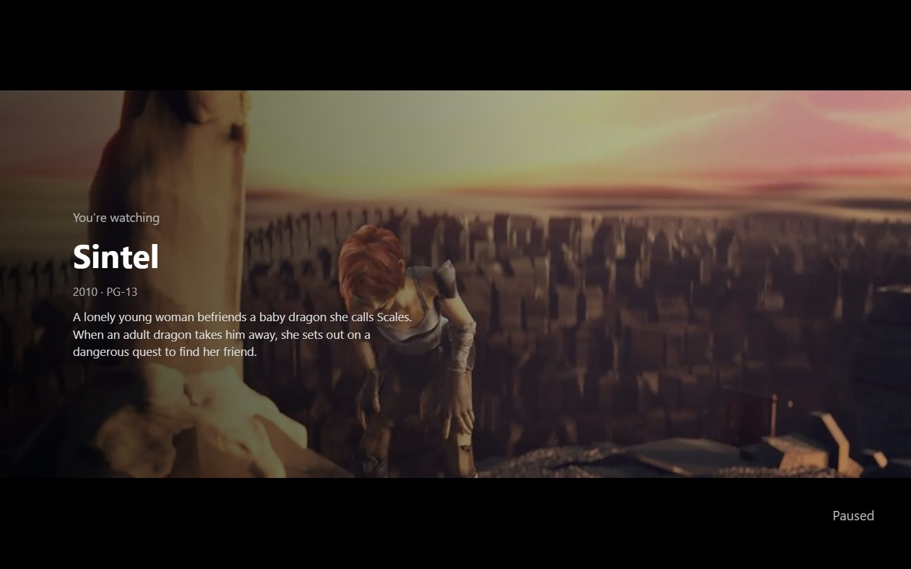 |
| *Player — Audio & Subtitles* | *"You're watching" pause screen* |
| 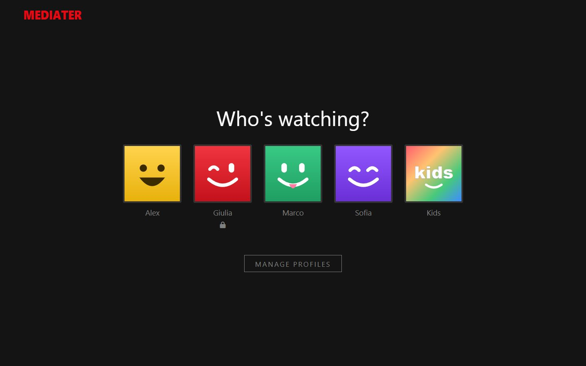 | 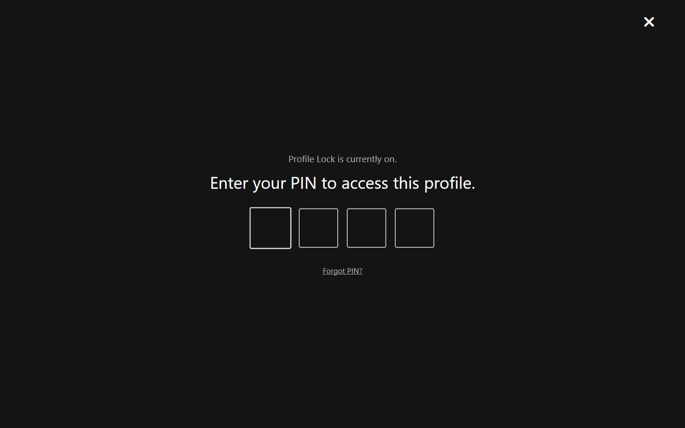 |
| *"Who's watching?" — Giulia's profile is locked* | *Profile Lock PIN* |
| 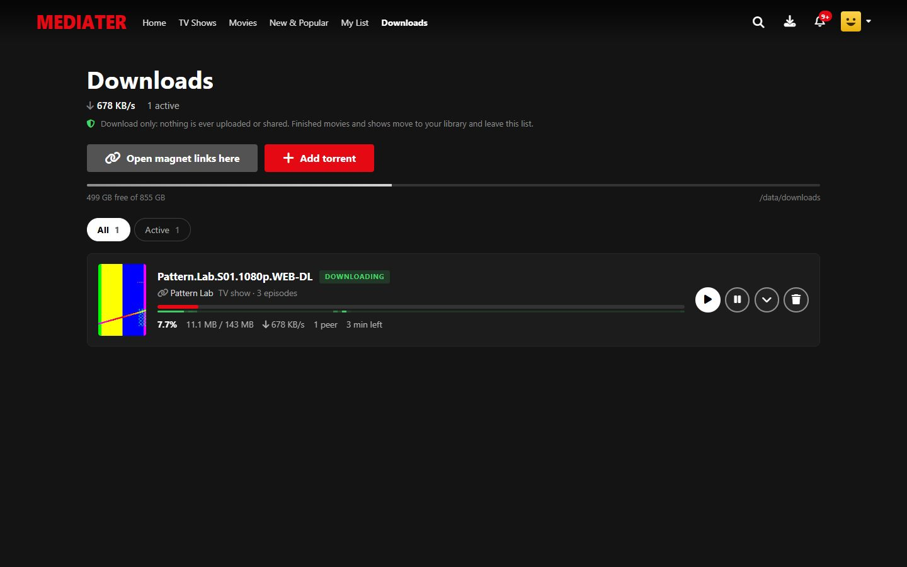 | 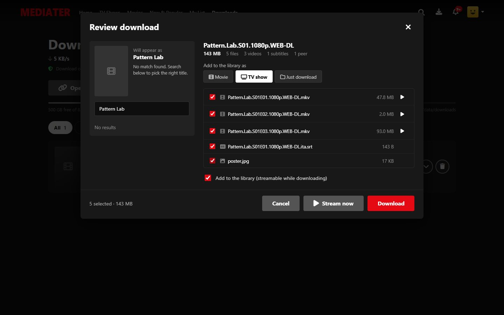 |
| *Downloads (admin) — download only* | *Review: pick files, preview, TMDB match* |
| 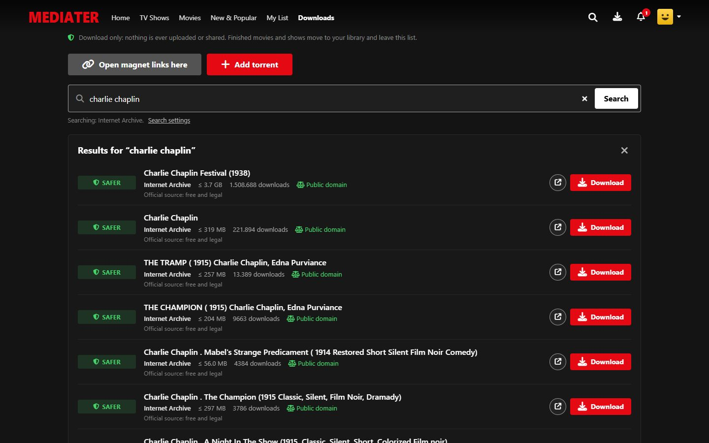 | |
| *Search — safest first (here: the Internet Archive)* | |

<p align="center">
  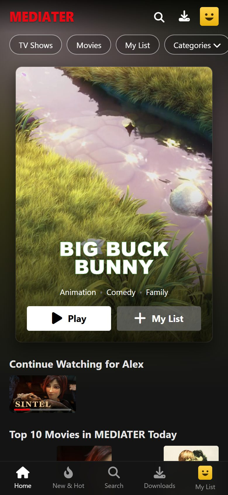
  &nbsp;
  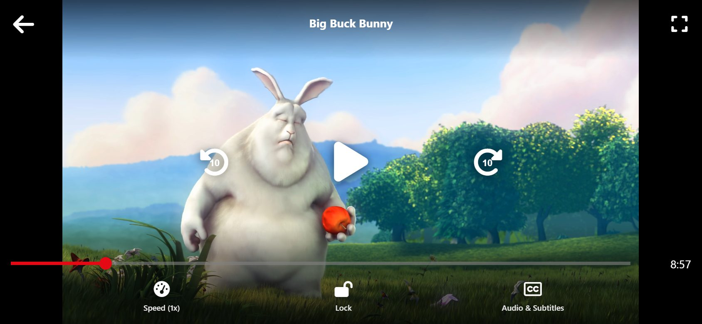
</p>

<sub>Screenshots show the Blender open movies (*Sintel*, *Big Buck Bunny*, *Tears of Steel*, *Cosmos Laundromat* — © Blender Foundation, CC BY) and public-domain silent-era posters from Wikimedia Commons. The download in progress is a locally generated test video.</sub>

---

## 🚀 Prerequisites

* **Node.js 22+** — [Download](https://nodejs.org/) *(or use Docker)*
* **ffmpeg** (recommended — needed for MKV/HEVC/AC3, thumbnails and subtitles)
  * Windows: `winget install Gyan.FFmpeg` · macOS: `brew install ffmpeg` · Debian/Ubuntu: `sudo apt install ffmpeg`
* **Git** — [Download](https://git-scm.com/)

---

## ⚡ Quick start

```bash
git clone https://github.com/Samuele98-git/Mediater.git
cd Mediater
```

### Option A — One-shot script (recommended)

```powershell
# Windows
.\scripts\setup.ps1
npm run dev
```

```bash
# Linux / macOS / WSL
./scripts/setup.sh   # installs deps, creates .env, generates SESSION_SECRET, sets up the database
npm run dev          # development with auto-reload
./scripts/start.sh   # production — uses PM2 if installed, otherwise foreground
```

### Option B — Docker (no Node required, ffmpeg included)

```bash
cp .env.example .env                 # then edit .env
docker compose up -d --build
docker compose logs -f
```

Everything persistent (database, uploads, downloads, thumbnails) lives in the `mediater_data` volume.

### Option C — Manual

```bash
cp .env.example .env                 # generate a SESSION_SECRET in here
npm install
npm start                            # applies the database schema, then starts
```

Open **http://localhost:3000** and sign in with the admin credentials from your `.env` (default: `admin / admin123` — **change immediately**).

---

## ⬆️ Upgrading from 2.x

```bash
git pull
npm install          # new dependencies (WebTorrent, Font Awesome…)
npm start            # the database is upgraded automatically — nothing is lost
```

Node **22** is now required. Existing titles, users, progress and My List are kept; every account becomes the first profile of its own "Who's watching?" screen. Users have to sign in again once (sessions moved into the database).

Coming from an earlier 3.0 build that kept finished torrents **seeding**: on the first start they are stopped and dropped from the Downloads list. Their titles stay in the library and keep playing from the files on disk.

---

## 🧲 Downloading with torrents

1. Open **Downloads** (top bar — only on the admin's own profile).
2. **Search** for a title and press *Download* on a result — or use **Add torrent** to paste a magnet link (or a `.torrent` URL / info hash), or drop a `.torrent` file.
3. Review: choose **Movie**, **TV show** or **Just download**, untick files you don't want, check the TMDB match. Press ▶ next to any video to **preview it without downloading everything**.
4. **Download** — or **Stream now** to start watching immediately.

### Search

Type a title in the search box at the top of **Downloads**. Results come back **safest first**:

| Rating | Meaning |
|---|---|
| 🟢 **Safer** | An official source (the Internet Archive), or a well-seeded torrent with a proper release name |
| ⚪ **OK** | Looks normal, but few people share it (slower, and fakes often look like this) |
| ⚫ **Dead** | Nobody is sharing it — hidden |
| 🔴 **Risky** | A program (`.exe`…) or an archive in the name, crack/installer keywords, or far too small for a movie — hidden |

Hidden results are one click away (*Show N hidden results*), each with the reason. **Download** opens the usual review, which double-checks the real file list: program files are flagged as probable malware and are never downloaded (the server refuses them too), and you're warned when the torrent's real size doesn't match what the listing claimed.

Sources (Settings → **Torrent search**):
* **Internet Archive** (on by default) — public-domain and Creative Commons films, cartoons and TV from its curated collections. Every item is an official torrent with archive.org itself as a web seed, so it downloads fast even with no peers. When an item comes in several versions (1080p, DVD, phone copies…), only the best one is pre-selected. A title already in your library (for example a poster without a video) gets the video instead of a duplicate.
* **Jackett / Prowlarr** (optional) — paste their Torznab feed URLs (one per line, e.g. `http://localhost:9117/api/v2.0/indexers/all/results/torznab/`) and the API key. Mediater has no built-in scrapers for other sites: it only searches what you connect, so only add indexers you trust.

**Download only.** Mediater never uploads: other peers are never unchoked, piece requests are refused, it doesn't advertise the pieces it has and it won't even hand out the torrent's file list. When a movie or show finishes, Mediater disconnects from the swarm, adds it to the library and removes it from the Downloads list — the files stay on disk and play from there. *Just download* items stay listed as *Completed* (also disconnected) so you can find or delete their files.

Who sees what:
* **The admin** sees a title as soon as its download starts, with a progress badge, and can stream it while it downloads (the player shows "Downloading 34% · 2 MB/s").
* **Everyone else** (family and kids profiles, viewer accounts) never sees downloads: a movie appears once it's complete, a season pack episode by episode as each one finishes — just like new titles on Netflix.

Tips:
* Click **Open magnet links here** once and your browser will open `magnet:` links in Mediater (needs HTTPS or localhost). The link only fills in the dialog: nothing is added until you click.
* Forward `TORRENT_PORT` (TCP+UDP) on your router for faster downloads.
* Settings → Torrent downloads: download speed limit, max connections.
* Removing a download can also delete its files. Titles that hadn't finished leave the library either way; files still used by the library are never deleted.

> ⚖️ Only download content you have the right to. Free & legal examples: the Blender open movies (*Sintel*, *Big Buck Bunny*, *Tears of Steel*, *Cosmos Laundromat* on [webtorrent.io](https://webtorrent.io/free-torrents)) and public-domain films on the Internet Archive.

---

## 🎨 Posters, logos & episode names (TMDB)

1. Create a free account at [themoviedb.org](https://www.themoviedb.org/) and copy your **API key** (Settings → API).
2. In Mediater: **Manage library → Settings → Metadata (TMDB)**, paste the key, save.

From then on downloads are matched automatically, **Quick add from TMDB** creates titles in two clicks, and **Identify on TMDB** in the title editor fixes any title. Without a key Mediater still works: it uses artwork shipped inside torrents and grabs a still frame from each video.

---

## 🛠 Makefile shortcuts

```bash
make help            # list every target
make setup           # first-time setup
make dev             # development mode
make start           # production mode (foreground)
make migrate         # apply the database schema
make reset-pin       # forgot the admin profile's PIN? removes it (or: npm run reset-pin)
make pm2-start       # run under PM2
make docker-up       # start Docker stack
make docker-logs     # tail container logs
make backup          # snapshot the DB, uploads and app data (not downloads) into ./backups/
```

---

## 🔐 Environment variables (`.env`)

| Variable | Required | Default | Notes |
|---|---|---|---|
| `NODE_ENV` | no | `development` | Set to `production` for tighter defaults |
| `PORT` | no | `3000` | HTTP port |
| `HOST` | no | `127.0.0.1` (dev) / `0.0.0.0` (prod) | Bind address |
| `SESSION_SECRET` | **yes in prod** | _(random in dev)_ | Long random string |
| `SESSION_TTL_DAYS` | no | `30` | Session lifetime |
| `COOKIE_SECURE` | no | `false` | `true` when serving over HTTPS |
| `TRUST_PROXY` | no | `1` in prod | Proxy hops to trust (Nginx, Cloudflare…). Use `0` when nothing sits in front, or the wrong-PIN limit can be dodged |
| `PUBLIC_URL` | no | — | Public address, used for SSO callbacks |
| `ADMIN_USERNAME` / `ADMIN_PASSWORD` | no | `admin` / `admin123` | Bootstrap admin — **change it** |
| `DATABASE_URL` | no | `file:./dev.db` | SQLite path (relative to `prisma/`) |
| `DATA_DIR` | no | `./data` | Downloads, thumbnail cache, saved .torrent files |
| `DOWNLOAD_DIR` | no | `DATA_DIR/downloads` | Where torrents are saved — point it at a big disk |
| `UPLOAD_DIR` | no | `./public/uploads` | Uploaded artwork, videos, subtitles |
| `TORRENT_PORT` | no | random (`6881` in Docker) | Forward it (TCP+UDP) for speed |
| `TORRENT_UPNP` | no | `true` | Open the port automatically via UPnP/NAT-PMP |
| `TORRENTS_ENABLED` | no | `true` | `false` turns the torrent client off |
| `TMDB_API_KEY` | no | — | Alternative to Admin → Settings |
| `FFMPEG_PATH` / `FFPROBE_PATH` | no | from `PATH` | Custom ffmpeg binaries |
| `FFMPEG_VIDEO_ENCODER` | no | `libx264` | `h264_nvenc`, `h264_qsv`, `h264_amf`, `h264_videotoolbox` for GPU transcoding |
| `MAX_TRANSCODES` | no | `4` | Simultaneous live conversions |

In **production**, if `SESSION_SECRET` is missing the server **refuses to start**.

---

## 🌐 Server deployment

### 1) Docker Compose behind Nginx

```bash
git clone https://github.com/Samuele98-git/Mediater.git /opt/mediater
cd /opt/mediater
cp .env.example .env    # set SESSION_SECRET, ADMIN_PASSWORD, COOKIE_SECURE=true
docker compose up -d --build
```

```nginx
server {
    listen 80;
    server_name media.example.com;
    client_max_body_size 50G;              # big video uploads

    location / {
        proxy_pass http://127.0.0.1:3000;
        proxy_http_version 1.1;
        proxy_set_header Host              $host;
        proxy_set_header X-Real-IP         $remote_addr;
        proxy_set_header X-Forwarded-For   $proxy_add_x_forwarded_for;
        proxy_set_header X-Forwarded-Proto $scheme;
        proxy_set_header Upgrade           $http_upgrade;
        proxy_set_header Connection        "upgrade";
        proxy_buffering    off;            # live downloads feed + video streams
        proxy_read_timeout 1h;
    }
}
```

Enable HTTPS with `certbot --nginx -d media.example.com`, then set `COOKIE_SECURE=true` and restart.

### 2) PM2 (no Docker)

```bash
sudo npm install -g pm2
cd /opt/mediater
./scripts/setup.sh
./scripts/start.sh      # applies schema changes and starts under PM2
pm2 startup && pm2 save
```

### 3) systemd

```ini
# /etc/systemd/system/mediater.service
[Unit]
Description=Mediater
After=network.target

[Service]
Type=simple
User=mediater
WorkingDirectory=/opt/mediater
EnvironmentFile=/opt/mediater/.env
ExecStartPre=/usr/bin/node /opt/mediater/scripts/migrate.mjs
ExecStart=/usr/bin/node /opt/mediater/server.js
Restart=on-failure
RestartSec=5
LimitNOFILE=65535

[Install]
WantedBy=multi-user.target
```

---

## 🧰 Safety checklist before going public

- [ ] `SESSION_SECRET` set to a long random string.
- [ ] `ADMIN_PASSWORD` changed from the default.
- [ ] `NODE_ENV=production`.
- [ ] HTTPS terminated by a reverse proxy, with `COOKIE_SECURE=true` and `TRUST_PROXY=1`.
- [ ] `client_max_body_size` raised and `proxy_buffering off` in your reverse proxy.
- [ ] The database, `public/uploads` and `data/` (or the Docker volume) backed up.
- [ ] Only the admin's own profile can download torrents and manage the library — keep other accounts as *Viewer*. Everyone who signs in picks a profile first, so if others share your sign-in, give your profile a PIN (Profile Lock — Mediater reminds you in Manage library until you do).

---

## ⌨️ Player keyboard shortcuts

| Key | Action |
|---|---|
| `Space` / `K` / `Enter` | Play / pause |
| `←` / `J` | Back 10 s |
| `→` / `L` | Forward 10 s |
| `↑` / `↓` | Volume up / down |
| `M` | Mute |
| `F` | Full screen |
| `S` | Skip intro |
| `N` | Next episode |
| `C` | Cycle subtitles |
| `Esc` | Close menus / modal |

On phones: double-tap left/right to skip 10 s, tap to show the controls, **Lock** to ignore taps while watching (tap the lock twice to unlock).

After three episodes that started on their own, the player asks *Are you still watching?* — any key press or click resets the count, like on Netflix.

---

## 🔌 HTTP endpoints

| Method | Path | Purpose |
|---|---|---|
| `GET` | `/` · `/browse/tv` · `/browse/movies` · `/latest` · `/browse/my-list` · `/browse/genre/:genre` | Browse pages |
| `GET` | `/search?q=` · `/title/:id` (or `?jbv=:id`) | Search, details modal |
| `GET` | `/profiles` | "Who's watching?" (+ `/profiles/new`, `/profiles/:id/edit`) |
| `GET` | `/watch/:id` | Player (series resume the right episode) |
| `GET` | `/stream/m/:id` | Range-aware direct stream |
| `GET` | `/stream/m/:id/transcode?mode=&audio=&start=` | Live remux/transcode (fragmented MP4) |
| `GET` | `/api/playback/m/:id?caps=` | Picks direct/remux/transcode for the browser, lists audio & subtitle tracks |
| `GET` | `/api/playback/m/:id/keyframe?t=` | Where a remux seek really starts (keeps the clock and subtitles exact) |
| `GET` | `/api/titles/:id` | Details modal data |
| `POST` | `/api/mylist/:id` · `/api/rate/:id` · `/api/progress` | My List, thumbs, resume position |
| `GET` | `/downloads` | Torrent manager (admin) |
| `GET` | `/api/torrents/search?q=` | Search the configured sources, safest first (admin) |
| `POST` | `/api/torrents` | Add magnet / .torrent / URL (admin) |
| `GET` | `/api/torrents/events` | Live stats (Server-Sent Events) |
| `POST` | `/api/torrents/:id/start` · `pause` · `resume` · `match` | Torrent control (admin) |
| `DELETE` | `/api/torrents/:id?files=1` | Remove (optionally delete files) |
| `GET` | `/healthz` | Liveness probe |
| `*` | `/admin/*` | Library, title editor, users, settings, system (admin) |

---

## 📂 Project structure

```
server.js              — entry point (sessions, security headers, routes)
lib/
  torrents.js          — BitTorrent engine (WebTorrent) with database-backed state
  library.js           — rows, Top 10, recommendations, kids filter, import & analysis
  ffmpeg.js            — probing, direct/remux/transcode decisions, thumbnails, subtitles
  tmdb.js              — TMDB client
  release-name.js      — parses "Show.S01E02.1080p.WEB-DL" style names
  subtitles.js, media-paths.js, session-store.js, settings.js, config.js …
routes/                — browse, api, stream, downloads, profiles, admin, auth, account
views/                 — EJS templates (browse, player, downloads, admin, profiles…)
public/css, public/js  — Netflix-style UI, player, downloads, admin
prisma/schema.prisma   — database schema (applied automatically on start)
scripts/               — setup / start / migrate
Dockerfile, docker-compose.yml, ecosystem.config.cjs, Makefile
```

---

## 🛠 Troubleshooting

**A video doesn't play / no sound** — install ffmpeg (see Prerequisites) and restart; Admin → System shows whether it was found. MKV with AC3/DTS audio, HEVC and AVI need it.

**Torrent stuck on "Fetching info"** — the torrent has no reachable peers. Try another source, or keep it running in the background; it starts as soon as a peer appears.

**Slow downloads** — set `TORRENT_PORT` and forward it (TCP + UDP) on your router. Because Mediater never uploads, peers that favour people who share back may send it less; well-seeded torrents download at full speed.

**Search finds nothing** — the built-in source, the Internet Archive, only has free public-domain and Creative Commons titles. Connect Jackett or Prowlarr in Settings → Torrent search to look elsewhere.

**I'm asked "Who's watching?" again** — that's on purpose after signing in and after the browser was closed, so a shared sign-in never opens straight into the admin's profile.

**Forgot a PIN** — a family member's: the account owner removes it from their own profile (Manage Profiles → that profile → Profile Lock). The admin's own: run `npm run reset-pin` on the server (Docker: `docker compose exec mediater npm run reset-pin`).

**`[torrents] uTP unavailable … continuing over TCP`** (Windows) — harmless: Windows reserved that UDP port; downloads continue over TCP.

**`SESSION_SECRET` error on startup** — set it in `.env` (production refuses to start without one).

**Database errors after an update** — run `npm install` then `npm start` (or `make migrate`).

**Backup from Docker** — `docker compose exec mediater sh -c "tar czf - --exclude=/data/downloads /data" > backup.tar.gz`
